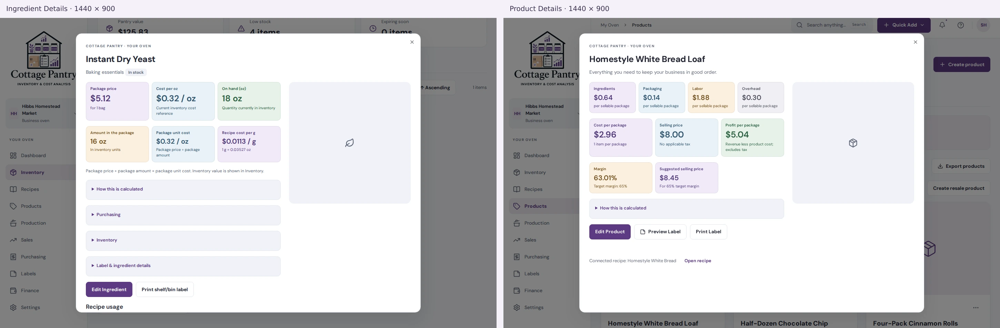
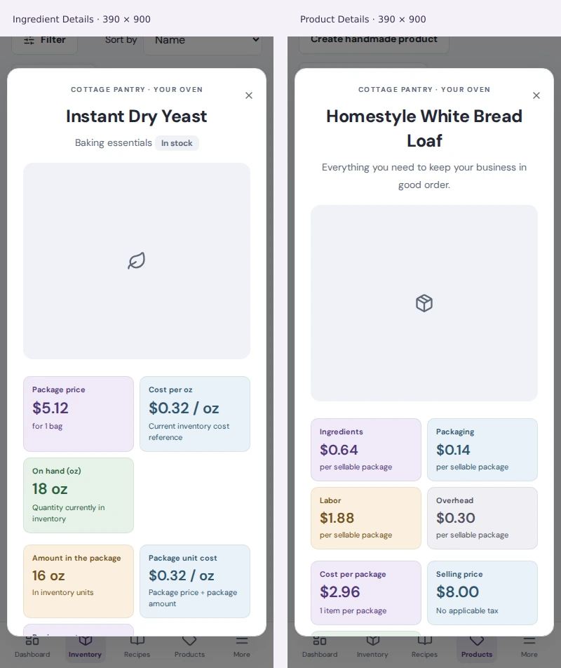
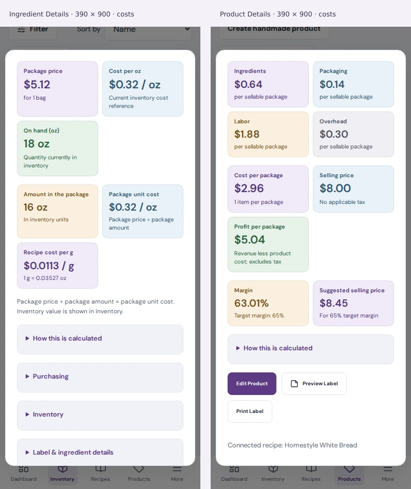

Ingredient Details reused the actual Product Details header and two-column information/photo markup through a shared component. Both popups used the same modal dimensions, padding, typography, column proportions, photo panel, calculation cards, expandable-section styling and button styles. Ingredient purchasing, complete label wording, inventory actions and history, verified conversions, vendor offers, editing, printing and recipe links remained available.

The default calculation display used soft-colored cards with labels, values and units. Product costs showed their breakdown before total cost, selling price, profit per package, margin and suggested price. Applicable taxes, customer totals and revenue excluding tax used separate cards. Ingredient package pricing remained distinct from the current inventory cost reference and inventory value. Detailed explanations stayed behind “How this is calculated.” Missing conversions displayed “Conversion needed,” and small unit costs retained readable precision.

The screenshots below came from the rendered application with synthetic demonstration records, captured in separate browser views at identical viewport sizes. The yeast example used an explicit fixture conversion of one bag to 16 oz and a $5.12 package price; customer records were not changed. The photo panels showed the actual empty-photo placeholders. The existing browser regression also checked that an uploaded portrait photo fitted completely inside the panel.

At 1440 × 900, both modal rectangles measured 1000 × 810 pixels with 28-pixel internal padding. At 390 × 900, both measured 370 × 810 pixels with 22-pixel padding. Browser comparisons checked matching column widths, title typography and placement, photo dimensions, card typography, expandable-section padding and button styling. Neither popup overflowed horizontally.

The mobile product name wrapped onto two lines and its description also wrapped; the ingredient name and description occupied one line each. This moved the product photo and following content lower while retaining the same shared layout. Ingredient Details had additional purchasing, inventory and label expansions, so its action row followed more sections and recipe links required scrolling. Product Details placed its actions after its single calculation expansion. These content-dependent vertical positions were not pixel-identical.

Validation passed 45 focused unit/component tests and eight browser checks. The checks covered cost formatting, saved and missing conversions, inclusive/exclusive tax presentation, unchanged underlying records, modal geometry, import loading/failure/retry, draft preservation, editing, cancellation, and existing linked actions. Type checking, focused lint, formatting and whitespace checks passed. Calculation logic, tax rules, database records, billing and Production settings remained unchanged; no build command was run.
