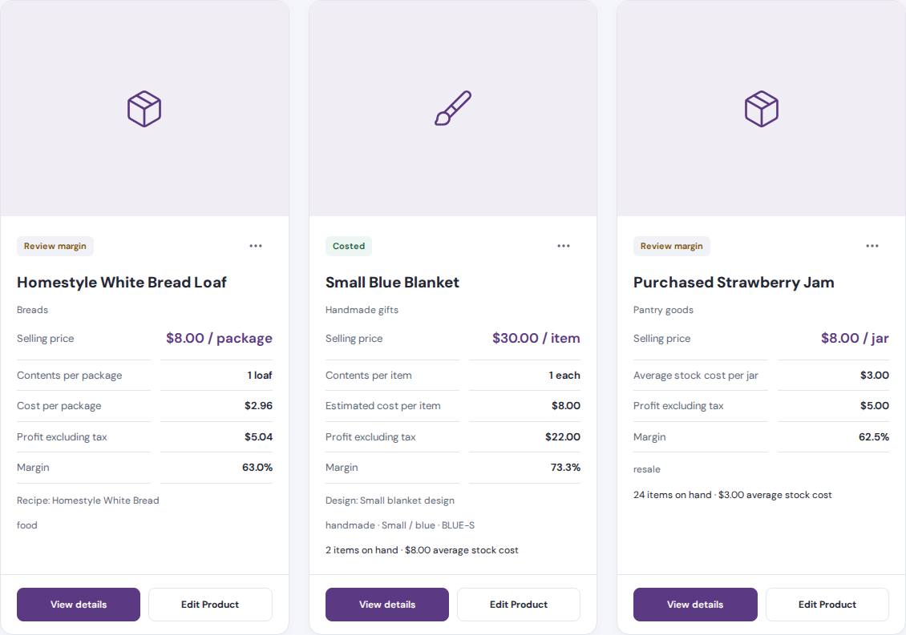
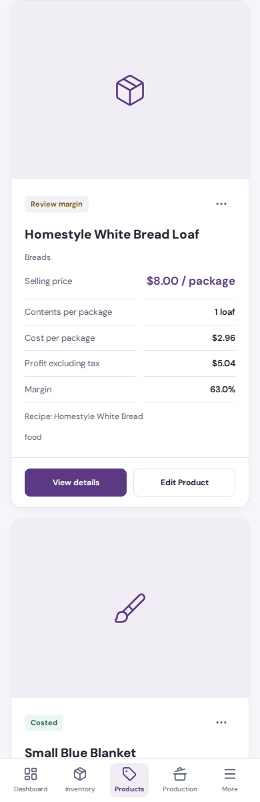

# Products overview card review

After approval of the representative row, all products use the approved photo-first cards. Search and the Food, Handmade and Resale filters still determine which records appear and preserve their order.

Cards retain the existing name, category, selling price and unit, contents per package where applicable, product cost or average stock cost, profit excluding tax, margin, connected recipe/design, variant/SKU, stock information and pricing-completeness badge. View details, Edit Product and label menu actions use their existing flows. No description paragraphs were added. Low-stock and out-of-stock badges reuse the existing inventory status helper for products with tracked finished stock.

The large 4:3 image frame contains the existing saved photo without stretching, cropping or changing its source. Missing and broken photos retain the existing neutral/type-specific icon fallback. White information panels, restrained purple accents and aligned footers preserve readable details beneath the image. The grid displays three columns on desktop, two on tablet and one on mobile.

These are browser captures of the actual app components with synthetic demo records. They show Food, Handmade and Resale examples; no customer records were used. The demo records have no assigned photos, so these captures intentionally show the supported placeholders. A separate browser check verified an assigned image retained its original source and intrinsic dimensions with `object-fit: contain`.

## Desktop sample row

## Mobile

[Full Products overview capture](previews/product-cards-review-overview.png)

Validation passed TypeScript, focused lint, formatting, and the 12 existing product-card/photo tests. Browser checks passed at 1440, 1024, 768, 390 and 320px with no horizontal overflow. Checks verified that all five fixture products received the design, including the second row, alongside aligned desktop footers, preserved type-specific details, search, type filters and detail/edit actions. Earlier sample checks covered assigned photos, deliberate zero and missing prices, negative profit, missing cost data and stock badges. Review interactions made no business-data writes. No build command was run.

The detail view, right-side detail image, Add/Edit popup, calculation functions, pricing/tax treatment, inventory operations, accounting and database files were unchanged. The approved rollout covers the full Products overview.
