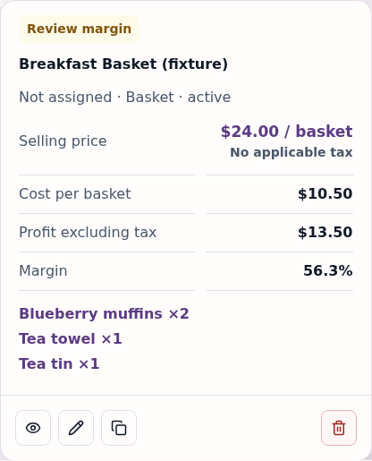
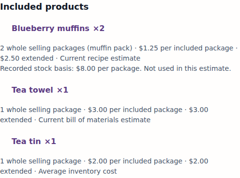
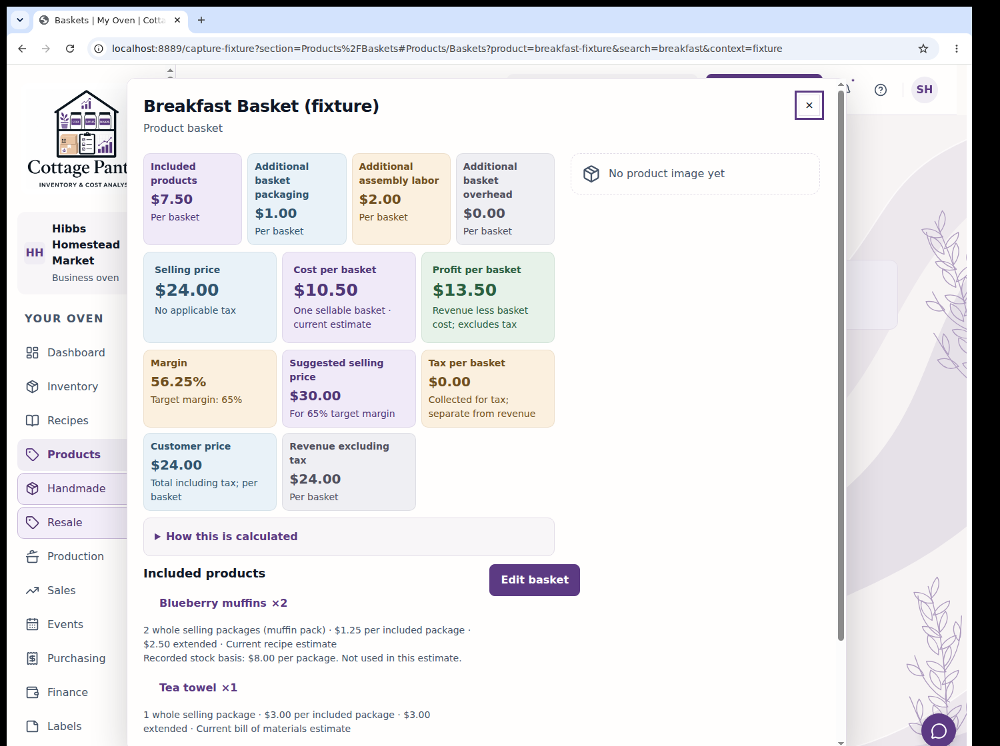
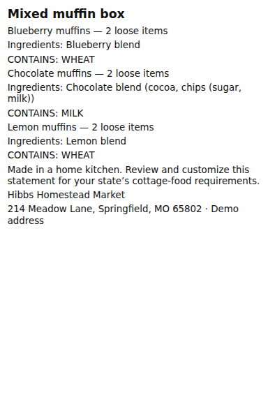

# Basket and assortment label review

These captures used an isolated browser fixture, not the private **Rise & Graze Breakfast Box** record. The fixture used two blueberry muffin packages at $1.25 each, one handmade tea towel at $3.00, and one resale tea tin at $2.00. The $7.50 component subtotal, $1.00 in added packaging, $2.00 in assembly labor, and no added overhead gave a **$10.50 current cost per basket**. The muffins' $8.00 recorded stock basis was shown separately and was not used in the estimate.

## Basket card and component costs

[Phone basket card](basket-card-390.png) · [Phone cost dialog](basket-details-390.png)

## Canonical browser address

Chromium entered the legacy `#Products/Kits` bookmark and normalized it to `#Products/Baskets`, retaining the selected fixture record, search, and context. Reload and browser history restored the correct view.

## Rendered label output

Chromium rendered a three-flavor, loose-item assortment on selected 4 × 6 in stock. The print output contained two pages at actual size, with distinct ingredient and allergen sections. The smaller stock was blocked for overflow. The [rendered PDF](assortment-print.pdf) was generated from the actual print window; no physical printer was used.

