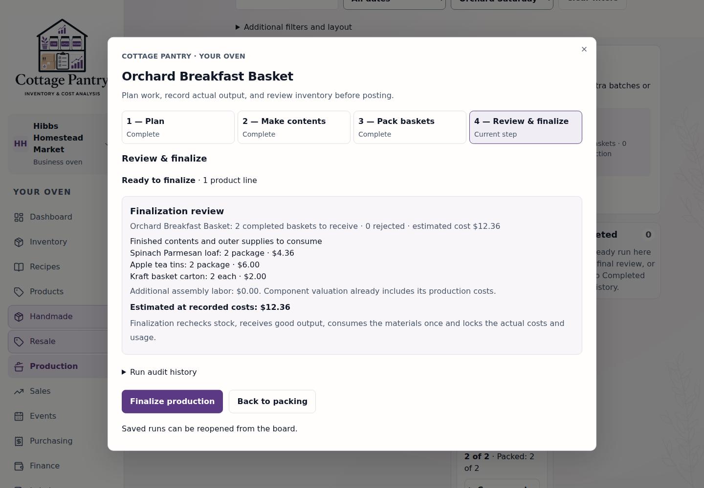

# Market basket production walkthrough

The screenshots were rendered in Chromium using an isolated orchard market with no customer order. The basket requires loaves and purchased tea tins. There were no finished loaves at planning time. The baker assigned tea already on hand and rounded fresh loaf production to one whole batch: three packages, two for the basket and one for the market. The browser test returned from the posted component run, recorded actual baskets, checked picked and packed quantities separately, reviewed the stock and cost changes, and retried once after a simulated failure.

| Step | Desktop | Phone (390 px, emulated touch) |
| --- | --- | --- |
| Market board | [Active market worksheet and board](desktop-00-market-board.png) | [Planned stage with linked work](phone-00-market-board.png) |
| Plan | [Stock choice and whole-batch preview](desktop-01-plan.png) | [Stock choice and component preview](phone-01-plan.png) |
| Make contents | [Open the linked component run](desktop-02-make.png) | [Component work from the parent](phone-02-make.png) |
| Pack | [Marked products and outer packaging](desktop-03-pack.png) | [Touch checklist with packed counts](phone-03-pack.png) |
| Review and finalize | [Finished stock, packaging, and assembly cost](desktop-04-review.png) | [Review and explicit confirmation](phone-04-review.png) |
| Completed | [Board at 100%](desktop-05-board-100.png) · [Board with 80% page zoom emulation](desktop-06-board-80.png) | — |

The browser fixture exercised the real production handler with synthetic records; a separate isolated PostgreSQL-compatible database test exercised the workspace transaction, constraints, inventory ledger, and retries. These captures do not show a live business or a deployed revision of these changes.
