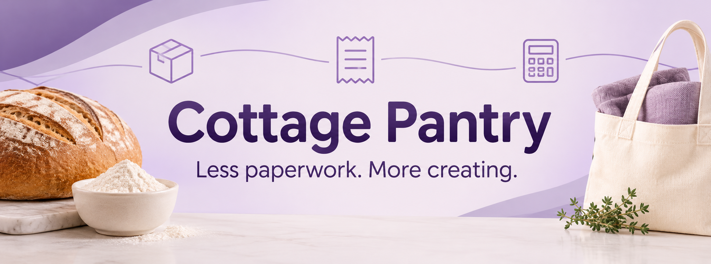
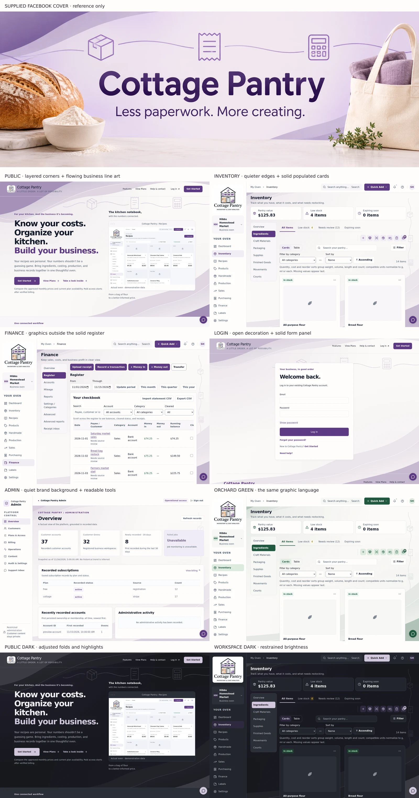

# Cover graphic direction — staged review

The supplied cover was inspected directly. Its graphic signature is the broad overlapping lavender ribbons in opposing corners, pale translucent folds and fine highlights, a flowing line connecting parcel, receipt and calculator illustrations, and a softly lit open center. The new original SVG composition carries those elements into the interface without copying the cover's title, tagline or product photographs into the background.

This is an opt-in design preview, before a broad rollout. Append `?cover-preview=1` to a page URL (or `&cover-preview=1` when it already has a query). For example: `/?cover-preview=1`, `/login?cover-preview=1`, `/oven?cover-preview=1#Inventory/Ingredients`, `/oven?cover-preview=1#Finance/Register`, and `/admin?cover-preview=1`. Each page can be opened directly with the preview parameter. Normal URLs retain the current background. Preview state is not saved as an appearance preference.

## Actual browser captures

All captures use the existing React pages/components. Customer records and admin session/metadata responses are synthetic browser fixtures. The admin shell, navigation, indicators and overview table actually rendered; no live administrator session was used. Customer appearance variants use the existing business appearance field. Public non-purple/dark variants and admin dark are explicit visual simulations using the existing generated palette tokens; they do not introduce a public selector or saved admin preference. Admin's default brand behavior remains unchanged.

| Surface | Purple light | Orchard Green | Purple dark | Mobile purple |
| --- | --- | --- | --- | --- |
| Public homepage | [View](home-cottage-light-1440.png) | [View](home-orchard-light-1440.png) | [View](home-cottage-dark-1440.png) | [View](home-cottage-light-390.png) |
| Inventory card grid | [View](inventory-cottage-light-1440.png) | [View](inventory-orchard-light-1440.png) | [View](inventory-cottage-dark-1440.png) | [View](inventory-cottage-light-390.png) |
| Dense Finance register | [View](finance-cottage-light-1440.png) | [View](finance-orchard-light-1440.png) | [View](finance-cottage-dark-1440.png) | [View](finance-cottage-light-390.png) |
| Login | [View](login-cottage-light-1440.png) | [View](login-orchard-light-1440.png) | [View](login-cottage-dark-1440.png) | [View](login-cottage-light-390.png) |
| Admin shell | [View](admin-cottage-light-1440.png) | Default brand retained | [Simulated dark](admin-cottage-dark-1440.png) | [View](admin-cottage-light-390.png) |

[Full populated Inventory grid](inventory-full.png) · [Full Finance register](finance-full.png). Other mobile palette variants are included alongside these files.

## Composition and safeguards

Public pages use the strongest corner folds and the horizontal illustrated thread. Authentication retains a solid form panel. Workspaces use restrained corner folds and a smaller vertical thread along the outer edge, with upright illustrations. Admin uses the quieter variant. The background is a static viewport composition, so it does not tile or restart at every section. Existing solid section and card surfaces naturally conceal it behind dense content. No layout spacer, hero, navigation change or decoration inside cards was introduced.

Artwork fills, strokes, highlights and depth derive from existing semantic palette tokens. Dark mode reduces their brightness. All eight palettes use the same geometry, with no raster recoloring or filters. The cover reference is included only in this review; it is not served as an interface background. The production artwork is lightweight inline SVG/CSS, hidden from assistive technology, excluded from printing, and unable to receive pointer or keyboard interaction. No animation, parallax, blur or extra image request was added.

Existing business-scoped preferences, layouts, typography, cost summaries, product images, uploads and mockup exports were retained. This revision changed no API, data schema, calculation, permission, authentication, billing or checkout implementation. No production mutation, charge or subscription change was sent.

## Verification

The browser review exercised all five requested surfaces at desktop and mobile sizes, the three representative palette/mode variants, all eight customer palettes in Light/Dark/System, responsive overflow, decorative accessibility and pointer behavior, populated Inventory/Finance records, and the absence of artwork on ordinary URLs. System used emulated OS appearance. TypeScript, focused ESLint and whitespace checks were also run. No build command was run. Live authentication, admin authorization, billing and checkout were not exercised as part of this visual review.
