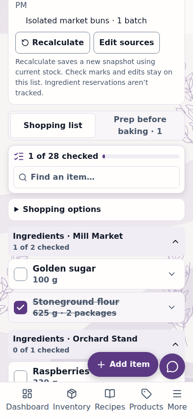
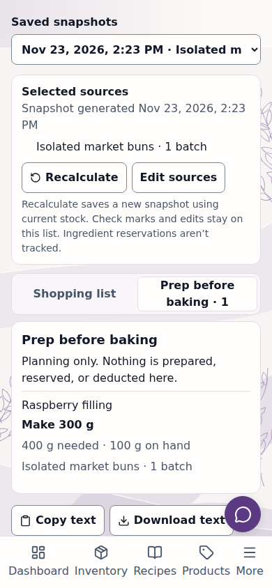

# Grocery & Prep verification

These Chromium captures used isolated production, stock, recipe, and shopping-list fixtures. They did not use the live workspace.

## Phone, 390 px

| Shopping — one item checked | Prep before baking |
| --- | --- |
|  |  |

[360 px phone](shopping-360.png) · [430 px phone](shopping-430.png) · [Landscape phone](shopping-844.png) · [820 px tablet](shopping-820.png) · [1440 px desktop](shopping-1440.png) · [Print view](print-390.png)

The browser checks covered taps on the row and check indicator, independent details and quantity controls, a touch swipe over a row, native checkbox semantics, Space and Enter, hiding and resetting checks, grouping and section collapse, manual items, text export, print styles, and offline replay across two separate browser contexts. The isolated PostgreSQL test exercised the migration, tenant isolation, snapshot persistence, and check conflict resolution with read-only permissions on production and inventory source tables.
