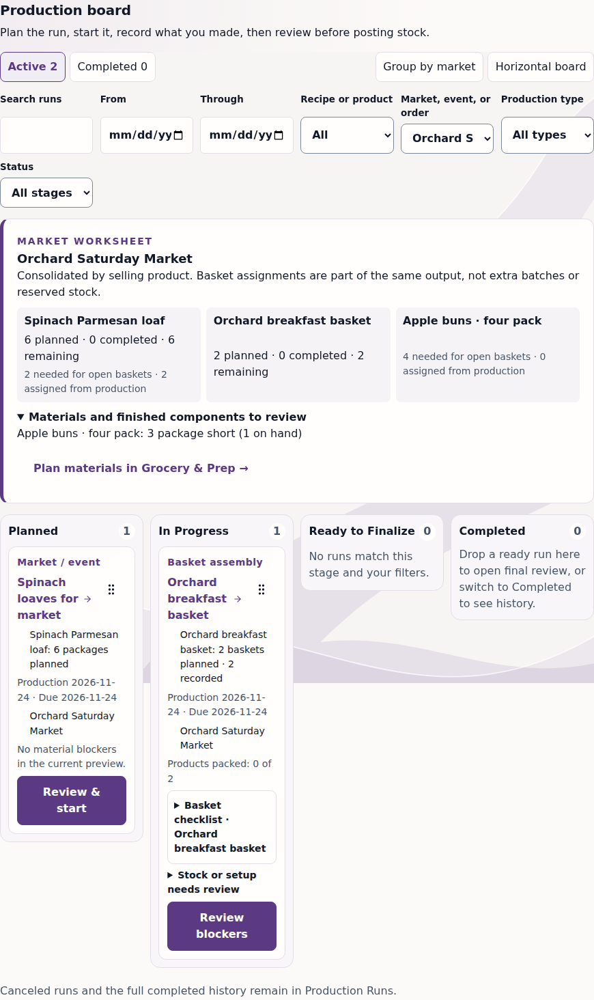
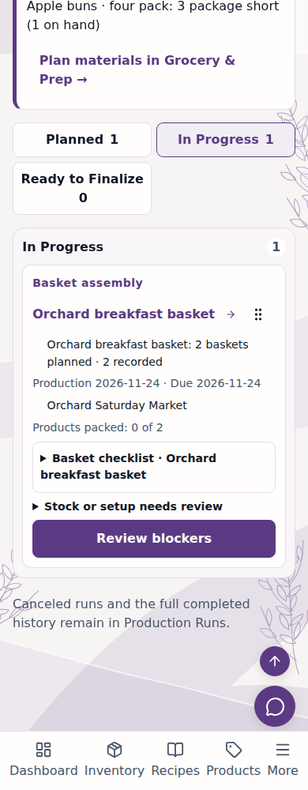
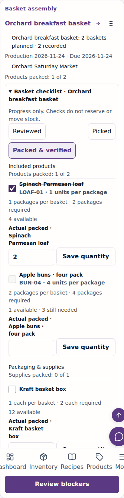
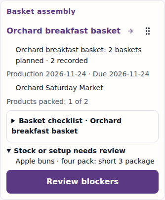

# Market production board verification

These screenshots show the updated workspace rendered in Chromium with synthetic production and stock records. They are not screenshots of a live business or a deployed revision of these changes.

## Market board

The Orchard Saturday Market worksheet shows six loaves planned, two assigned to baskets within the same batch, and a shortage of three apple-bun packages. No customer order is needed for either market run.

## Phone stage view

Stage tabs show counts, and the selected lane displays full-width cards without requiring horizontal scrolling.

## Expanded basket

The checklist separates included products from packaging and shows independent Reviewed, Picked, and Packed & verified states. The saved progress does not reserve stock.

## Shortage and next action

The basket names the exact missing component and provides a **Review blockers** action. Opening the action does not post inventory.

