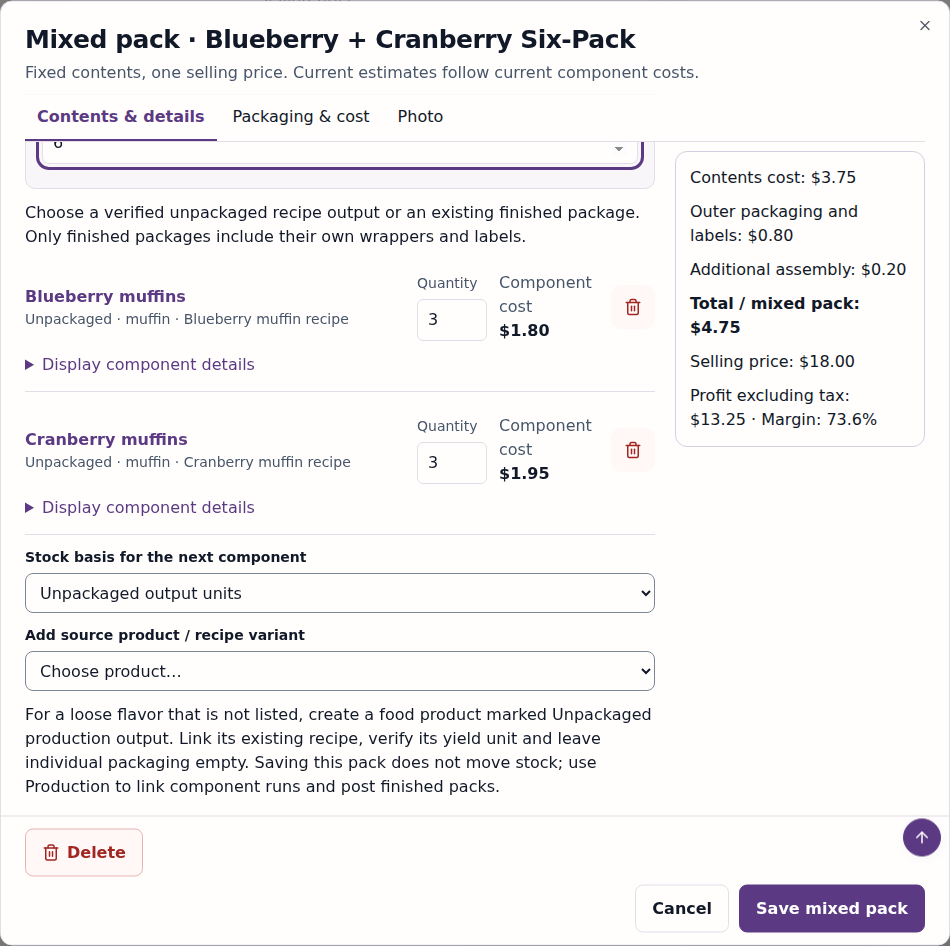
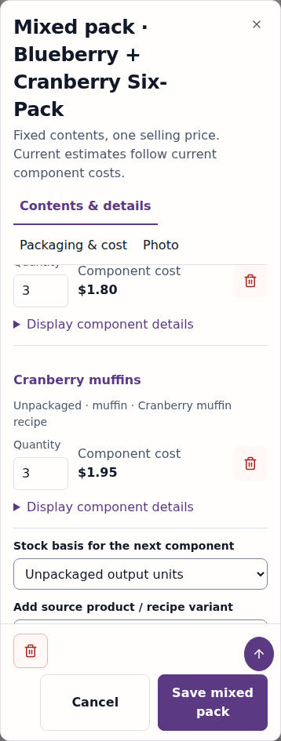
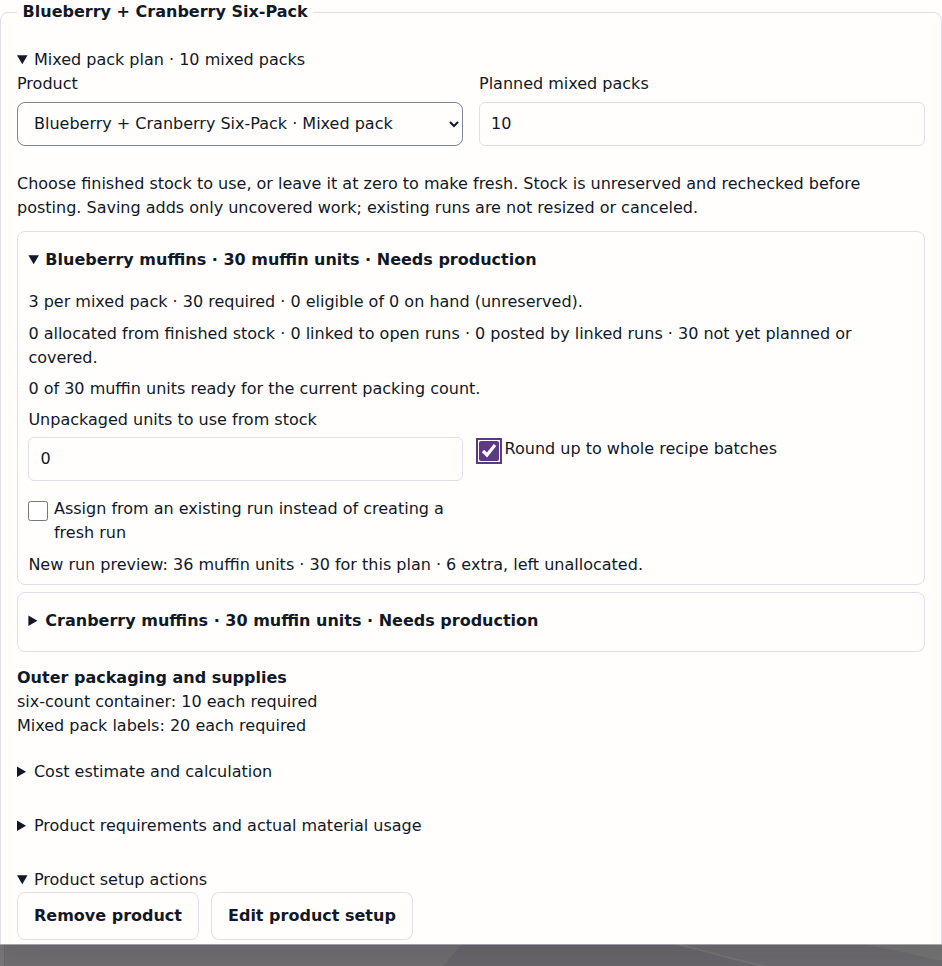
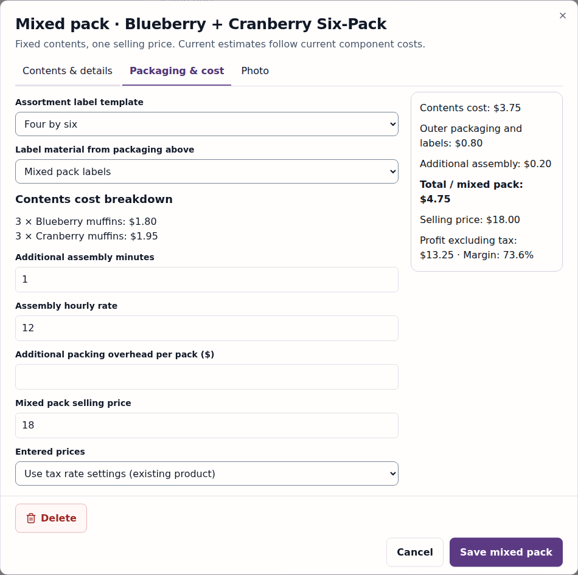
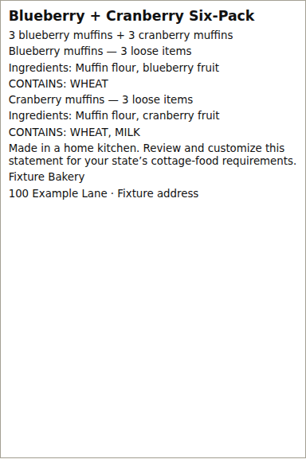

# Mixed-content six-pack verification

These screenshots were rendered in Chromium with isolated fixture records. They do not show a production workspace or a physical printout.

## Setup and expected result

1. In Products, create an **Unpackaged production output** for each flavor. Link its existing recipe and confirm that the recipe yield counts individual muffins. Leave the output’s Packaging empty. This makes a separately tracked output without copying its recipe or creating a sellable individual package.
2. In **Create product → Multiple products / flavors in one package**, add three blueberry muffins and three cranberry muffins as unpackaged output. Set the optional expected count to six. In **Packaging & cost**, add one six-count container and the label stock quantities, then select the assortment label template and designated label material. Choose the selling price and the appropriate existing product category and tax setup.
3. In Production, use **Assemble** to plan ten mixed packs. The fixture needs 30 blueberry muffins, 30 cranberry muffins, 10 containers, and 20 labels (two per pack). An explicit whole-batch choice for a 12-muffin blueberry recipe makes 36, of which six stay unallocated in the no-stock preview. Saved plans can allocate eligible existing output or create linked runs only for unmet demand.
4. Review the planned contents, complete the needed muffin runs, and confirm picking and packing before posting the parent. Record sales against completed mixed-pack stock, not against the unpackaged muffin records.
5. Open the saved product or run in Assortments. The label reads **3 blueberry muffins + 3 cranberry muffins** and shows each flavor’s reviewed ingredients and allergens separately. Printing and confirming labels does not deduct the stock a second time.

The fixture costs **$4.75 per pack**: $1.80 blueberry output, $1.95 cranberry output, $0.60 container, $0.20 label stock, and $0.20 additional packing labor. Explicitly including the wrapped blueberry product uses its full packaged cost instead. Existing recipe production supplies still apply to the muffin runs; attached selling packaging and legacy flat recipe packaging charges do not apply to unpackaged outputs.

## Rendered screenshots

**Product contents · desktop**

**Product contents · 390 px phone viewport**

**Production breakdown**

**Cost breakdown**

**Label preview**

## Scope

The feature reused the existing Netlify Database product records, assembly planning, production and stock ledger, category tax and sales workflows, Grocery & Prep, and assortment label review. No schema migration was required. The combination is fixed; changes require updating the saved definition and reviewing affected open plans and labels again. The illustrated print path uses the existing assortment template for label stock dimensions, not arbitrary artwork, and does not verify a physical printer. The feature was verified locally, not on a deployed revision.
