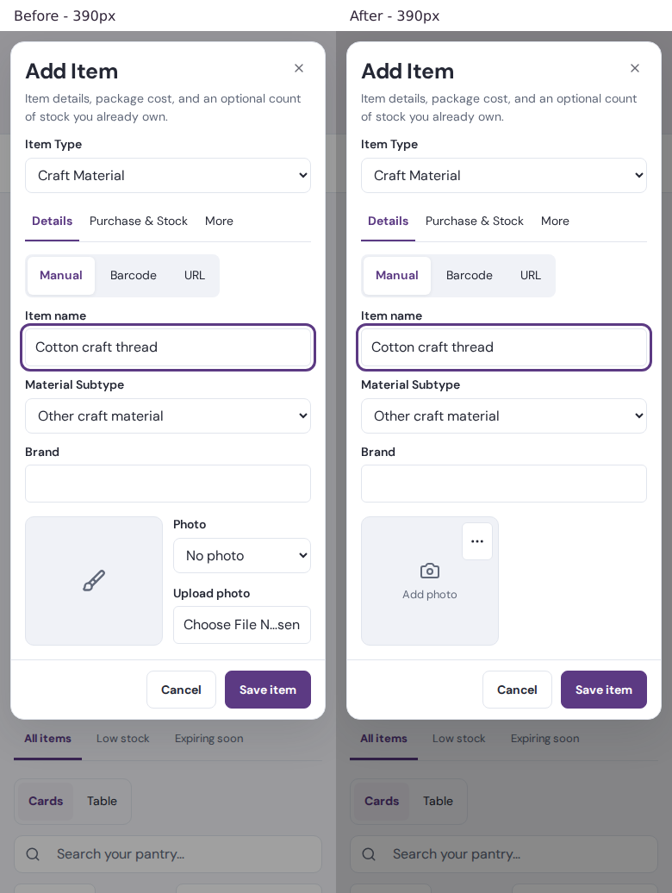

The app’s item photo fields were replaced with one shared clickable photo box. The entire preview opened the native image picker, displayed a local preview immediately, and allowed replacement by clicking the current photo. Separate Remove photo and Photo options controls stayed inside the box without triggering the picker. Keyboard focus remained on the photo after removal. Existing saved and imported images remained available in the compact menu.

Photo uploads retained the existing private image-library endpoint, asset category/collection, permissions, PNG/JPEG/WebP support, 5 MB limit, and server validation. Uploading an asset did not create or save an item. The current form draft received the uploaded asset link only after a successful upload; failures restored the previous preview and displayed an inline error associated with the control. Only the surrounding form’s Save committed the record’s photo link. Cancel discarded the record change; assets already uploaded to the image library retained the existing library behavior. No saved asset was deleted during replacement or removal. No schema, migration, or server handler changed.

The following existing forms were updated through the shared control:

| Form or interface | Coverage |
| --- | --- |
| Add Item | Ingredients, Packaging, Craft Materials (including fabric/yarn), Supplies, and Resale |
| Ingredient and Packaging editors | Existing photo area and tabs; legacy ingredient/packaging editor also reused the control |
| Material/fabric editors | Fabric Edit Material and the existing material workflow fallback |
| Food products | Create/Edit Images & Labels panel |
| Handmade and resale products | Existing product editor’s Images & Labels panel |
| Kits | Photo tab, retaining its existing 90 × 70 preview size |
| Product import reference screenshots | Both existing screenshot upload paths; reference images stayed separate from product photos |
| Package photo import | Front, back/label, and optional close-ups; rotation, extraction, cancellation, and review retained their behavior |

Read-only Ingredient Details, recipe-usage content, Product Details, inventory photos, and editor title thumbnails retained their existing viewing/navigation behavior. Label artwork, business logos, and Graphics Library upload/link management remained specialized artwork workflows. Support screenshots, recipe-document scans, receipts, policy documents, CSV imports, and font uploads were attachment/import workflows and stayed unchanged.

Existing photo sizes, placement, and contain cropping were retained. These matching screenshots were captured from the actual rendered application using synthetic workspace data before editing and after implementation. The before images were captured before replacing the original controls; the after images were captured during the final successful browser run.

| Viewport | Empty before | Empty after | Selected before | Selected after | Side by side |
| --- | --- | --- | --- | --- | --- |
| Phone · 390 × 1000 | [Before](before-add-material-390.png) | [After](after-add-material-390.png) | [Before](before-selected-390.png) | [After](after-selected-390.png) | [Comparison](comparison-390.png) |
| Tablet · 768 × 1000 | [Before](before-add-material-768.png) | [After](after-add-material-768.png) | [Before](before-selected-768.png) | [After](after-selected-768.png) | [Comparison](comparison-768.png) |
| Desktop · 1440 × 1000 | [Before](before-add-material-1440.png) | [After](after-add-material-1440.png) | [Before](before-selected-1440.png) | [After](after-selected-1440.png) | [Comparison](comparison-1440.png) |

Additional rendered evidence included the [saved-photo menu](after-photo-menu-390.png), [Ingredient editor](after-ingredient-edit-390.png), [food product](after-food-product-390.png), [handmade product](after-handmade-product-390.png), [resale editor](after-resale-product-390.png), [kit](after-kit-390.png), [fabric editor](after-fabric-edit.png), [package extraction review](package-photo-review-390.png), and [keyboard focus](after-keyboard.png). The unchanged read-only [Ingredient Details](after-readonly-ingredient-details-390.webp) and [Product Details reference](after-readonly-product-details-reference-390.webp) were captured by the existing layout regression tests. Corresponding desktop captures were included alongside these files.

Validation passed 116 unit tests across 10 suites, with one optional live-retailer test skipped. These included upload previews before network completion, successful replacements, failed uploads, size validation, empty picker selections, draft-only removal, independent native controls, imported photo permissions, selected URL import fields, screenshot imports, and package extraction cancellation/rotation. The final browser run passed all 15 tests: five Add Item types at three widths, add/replace/remove, picker cancellation, form cancellation, save payloads, saved/imported image selection, tab retention, photo dimensions/cropping, keyboard focus and activation, product/kit/fabric controls, phone touch input, barcode lookup, and package-photo review. Two additional existing Ingredient/Product Details layout checks passed at phone and desktop widths. TypeScript, lint on the shared/new modules and package import, and whitespace checks passed. Actual output was saved in [validation.txt](validation.txt).

Eight failures in two older suites were reproduced on an isolated copy of the unchanged repository source: five relied on an Identity mock missing hydrateSession, and three expected an outdated Purchase unit label. Those pre-existing tests were not deleted or weakened. Their baseline output was summarized in [baseline-failures.txt](baseline-failures.txt). The catalog-photo browser fixture was updated to enable the existing package-photo pilot in synthetic data and accept its existing compact/noncompact summary labels; production feature permissions were unchanged.

Browser verification used Chromium with responsive viewports and an additional 390 × 844 touch/mobile context. Native picker cancellation was represented by an empty file selection; physical OS picker dismissal, real-device Safari, and physical device keyboard behavior were not verified. All workspace API writes and extraction responses in browser tests were intercepted with disposable fixtures; no customer records, stock, or expenses were changed. Live retailer availability and live storage uploads were not exercised. Build commands were not run; deployment validation remained with the hosting platform. These edits and captures were local and were not claimed verified in a deployed version.
