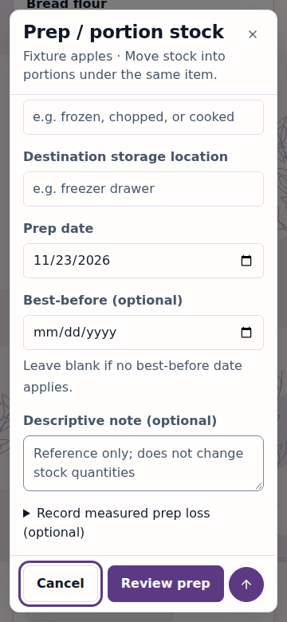
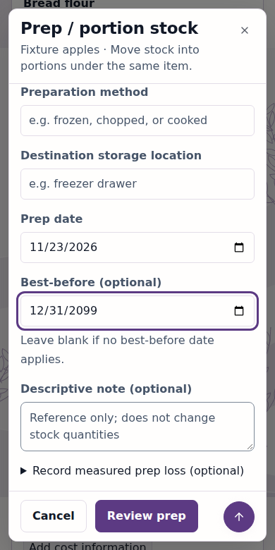
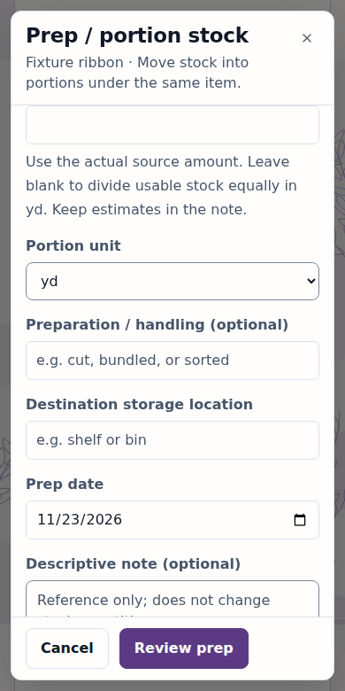
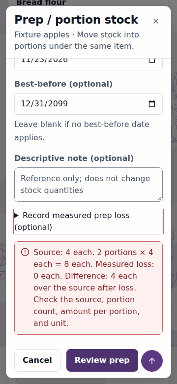
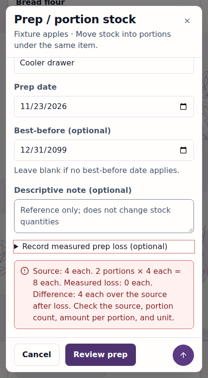
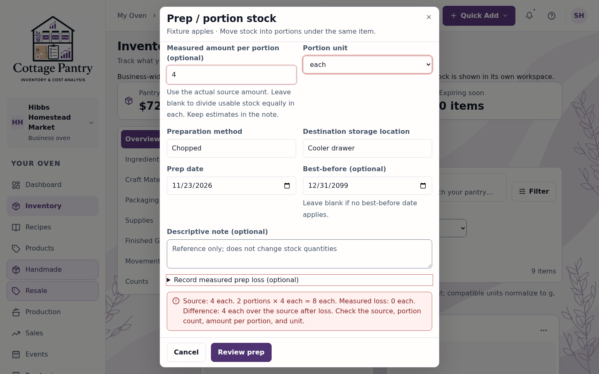

# Prep / portion stock — rendered verification

These screenshots used synthetic inventory in Chromium. The phone captures used portrait touch emulation; they did not exercise the native iOS Safari date picker.

| Empty Best-before · 360 px | Filled Best-before · 390 px | Craft material · 390 px |
| --- | --- | --- |
|  |  |  |

| Calculated error · 360 px | Calculated error · 430 px |
| --- | --- |
|  |  |

